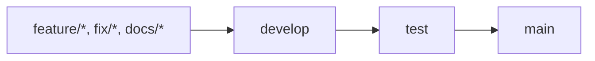

# IA Ecossistema

Repositório de ecossistemas de IA, artefatos de orquestração e ferramentas locais para estruturar, executar e evoluir soluções com agentes, workflows, skills e RAG.

## Visão geral

O projeto reúne materiais reutilizáveis para educação, contexto empresarial e operação de ecossistemas de IA. Cada núcleo preserva seus próprios documentos de instalação, modelos, testes e referências.

| Núcleo | Finalidade |
| --- | --- |
| [ecossistema-educacional](./ecossistema-educacional) | Kit de ecossistema de IA por prompts com domínio, orquestradores, agentes, workflows, skills e RAG para Educação. |
| [ecossistema-empresa](./ecossistema-empresa) | Ecossistema empresarial estruturado, com agentes, integrações documentadas e materiais de apoio. |
| [painel](./painel) | Console local para explorar, validar e executar ecossistemas em simulação ou com provedores configurados. |
| [ferramentas](./ferramentas) | Utilitários e materiais de apoio para leitura, organização e demonstração. |

## Começar pelo painel

O painel requer Node.js 20 ou superior.

```bash
cd painel
npm ci
npm test
npm run verificar
npm start
```

No primeiro uso, consulte [painel/README.md](./painel/README.md) para configurar o ambiente local. Chaves de provedores ficam exclusivamente no arquivo `.env`, que não deve ser versionado.

## Organização dos ecossistemas

Os pacotes adotam uma estrutura modular. Os artefatos podem incluir:

- domínio e orquestradores;
- multiagentes, agentes e subagentes;
- workflows, skills e bases RAG;
- adaptadores para plataformas;
- templates, testes e arquivos de distribuição.

Consulte os guias específicos em:

- [Ecossistema educacional](./ecossistema-educacional/README.md)
- [Ecossistema empresarial](./ecossistema-empresa/README.md)
- [Painel da Fábrica de IA](./painel/README.md)

## Fluxo de contribuição

O fluxo esperado é:



- Use Pull Requests para alterações.
- Execute os testes do componente alterado.
- Não envie credenciais, arquivos `.env` ou dados pessoais.
- Leia [CONTRIBUTING.md](./CONTRIBUTING.md) e [SECURITY.md](./SECURITY.md) antes de contribuir.

## Configuração do repositório

As configurações versionadas estão em [docs/CONFIGURACAO_REPOSITORIO.md](./docs/CONFIGURACAO_REPOSITORIO.md). Ela também registra a descrição e os tópicos recomendados para o campo **About** do GitHub.

## Status

O conteúdo dos núcleos possui níveis distintos de maturidade. Verifique o README de cada área antes de considerar uma integração, execução externa ou conexão com provedores como disponível em produção.
